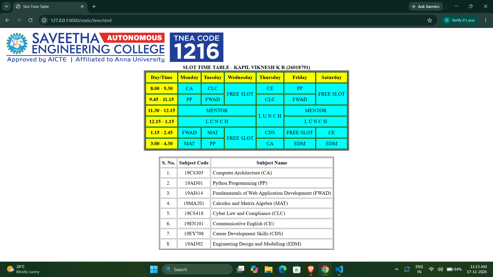

# Ex04 Time Table
## Date:
17.11.2026

## AIM
To write a html webpage page to display your slot timetable.

## ALGORITHM
### STEP 1
Create a Django-admin Interface.

### STEP 2
Create an App inside the Django project.

### STEP 2
Create a static folder uder the created App and insert HTML code.

### STEP 3
Create a simple table using ```<table>``` tag in html with the relevant attributes.

### STEP 4
Add rows using ```<tr>``` tag.

### STEP 5
Add your course schedule using ```<td>``` tag.

### STEP 6
Execute the program using runserver command.

## PROGRAM
```

<html>
<head>
<title>Slot Time Table</title>
</head>
<body>

<table border="4" bordercolor="gray" cellspacing="3" cellpadding="6" align="center" bgcolor="green">
  <caption><b>SLOT TIME TABLE - KAPIL VIKNESH K R (26018791)</b></caption>

  <tr bgcolor="yellow" align="center">
    <th>Day/Time</th>
    <th>Monday</th>
    <th>Tuesday</th>
    <th>Wednesday</th>
    <th>Thursday</th>
    <th>Friday</th>
    <th>Saturday</th>
  </tr>

  <tr align="center">
    <th bgcolor="yellow">8.00 - 9.30</th>
    <td bgcolor="cyan">CA</td>
    <td bgcolor="cyan">CLC</td>
    <td bgcolor="cyan" rowspan="2">FREE SLOT</td>
    <td bgcolor="cyan">CE</td>
    <td bgcolor="cyan">PP</td>
    <td bgcolor="cyan" rowspan="2">FREE SLOT</td>
  </tr>

  <tr align="center">
    <th bgcolor="yellow">9.45 - 11.15</th>
    <td bgcolor="cyan">PP</td>
    <td bgcolor="cyan">FWAD</td>
    <td bgcolor="cyan">CLC</td>
    <td bgcolor="cyan">FWAD</td>
  </tr>

  <tr align="center">
    <th bgcolor="yellow">11.30 - 12.15</th>
    <td bgcolor="cyan" colspan="3">MENTOR</td>
    <td bgcolor="cyan" rowspan="2">L U N C H</td>
    <td bgcolor="cyan" colspan="2">MENTOR</td>
  </tr>

  <tr align="center">
    <th bgcolor="yellow">12.15 - 1.15</th>
    <td bgcolor="cyan" colspan="3">L U N C H</td>
    <td bgcolor="cyan" colspan="2">L U N C H</td>
  </tr>

  <tr align="center">
    <th bgcolor="yellow">1.15 - 2.45</th>
    <td bgcolor="cyan">FWAD</td>
    <td bgcolor="cyan">MAT</td>
    <td bgcolor="cyan" rowspan="2">FREE SLOT</td>
    <td bgcolor="cyan">CDS</td>
    <td bgcolor="cyan">FREE SLOT</td>
    <td bgcolor="cyan">CE</td>
  </tr>

  <tr align="center">
    <th bgcolor="yellow">3.00 - 4.30</th>
    <td bgcolor="cyan">MAT</td>
    <td bgcolor="cyan">PP</td>
    <td bgcolor="cyan">CA</td>
    <td bgcolor="cyan">EDM</td>
    <td bgcolor="cyan">EDM</td>
  </tr>

</table>

<br>

<table border="3" bordercolor="gray" cellspacing="2" cellpadding="5" align="center">
  <tr align="center">
    <th>S. No.</th>
    <th>Subject Code</th>
    <th>Subject Name</th>
  </tr>

  <tr>
    <td align="center">1.</td>
    <td align="center">19CS305</td>
    <td>Computer Architecture (CA)</td>
  </tr>
  <tr>
    <td align="center">2.</td>
    <td align="center">19AI301</td>
    <td>Python Programming (PP)</td>
  </tr>
  <tr>
    <td align="center">3.</td>
    <td align="center">19AI414</td>
    <td>Fundamentals of Web Application Development (FWAD)</td>
  </tr>
  <tr>
    <td align="center">4.</td>
    <td align="center">19MA201</td>
    <td>Calculus and Matrix Algebra (MAT)</td>
  </tr>
  <tr>
    <td align="center">5.</td>
    <td align="center">19CS418</td>
    <td>Cyber Law and Compliance (CLC)</td>
  </tr>
  <tr>
    <td align="center">6.</td>
    <td align="center">19EN101</td>
    <td>Communicative English (CE)</td>
  </tr>
  <tr>
    <td align="center">7.</td>
    <td align="center">19EY708</td>
    <td>Career Development Skills (CDS)</td>
  </tr>
  <tr>
    <td align="center">8.</td>
    <td align="center">19AI302</td>
    <td>Engineering Design and Modelling (EDM)</td>
  </tr>

</table>

</body>
</html>

```

## OUTPUT


## RESULT
The program for creating slot timetable using basic HTML tags is executed successfully.
